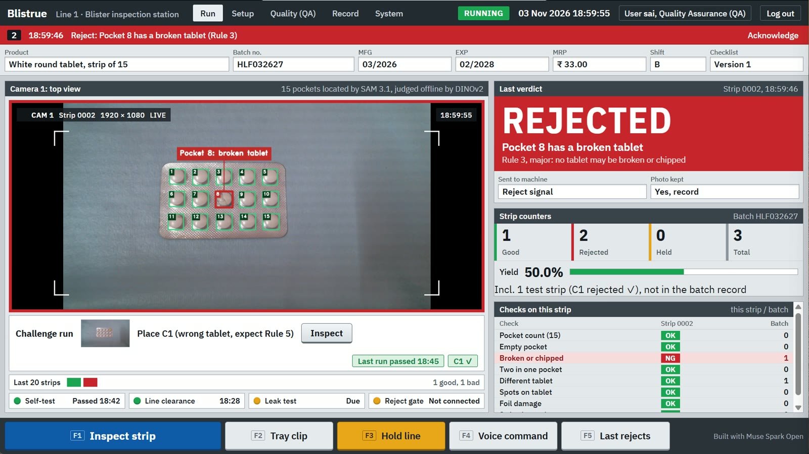
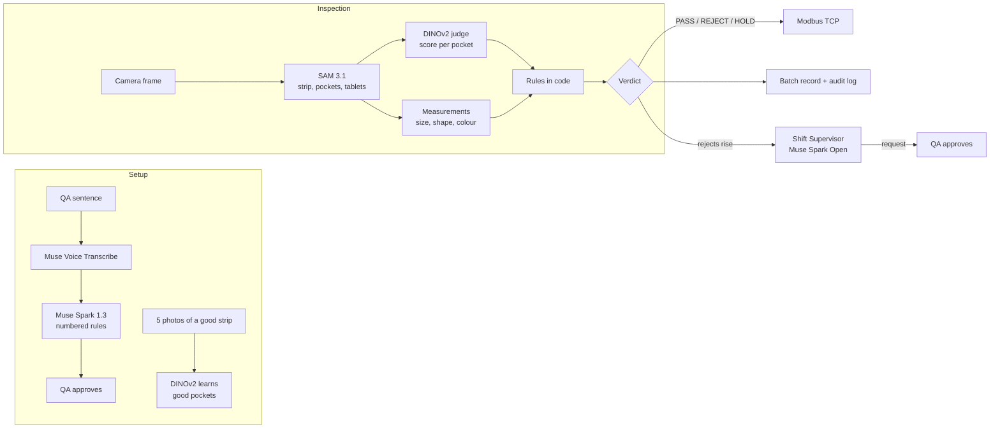

# Blistrue

**Blister-strip inspection station: a webcam, a laptop and five Meta models.**

Blistrue checks every pocket of a tablet blister strip, names the rule that failed, signals the packing machine and keeps the batch record for QA to sign. QA sets the rules with one spoken or typed sentence. A frozen vision model and plain code make the pass/fail decision; no language model does.

**Demo video (3 min):** https://www.youtube.com/watch?v=n9GZ3uQREwk — one full shift on a bench with real strips, recorded live.



## Features

- **Rules from one sentence.** Muse Voice Transcribe hears the rule, Muse Spark 1.3 turns it into a numbered checklist, and QA approves it. Every approved checklist is versioned.
- **Per-pocket inspection.** SAM 3.1 outlines the strip, each pocket and each tablet; a frozen DINOv2 judge, taught from five photos of a good strip, scores every pocket. It finds empty pockets, broken tablets, two tablets in one pocket, a different tablet, spots, foil damage, a wrongly cut strip and a wrong pocket count.
- **Foil print check.** Muse Spark reads batch, MFG, EXP, MRP, product name and strength; code compares them with the batch record. A difference holds the strip for QA to decide.
- **Proves itself before every batch.** A self-test paints defects onto a good strip and must catch and name each one. Physical challenge strips must be rejected for the right rule. A miss locks the station.
- **Line control.** Reject, hold and lock signals go out over Modbus TCP. Three rejects in a row, or any critical finding, holds the line until QA resumes it.
- **Shift Supervisor agent.** Muse Spark Open investigates a rise in rejects or a failed self-test with measuring tools. It can hold the line and draft a deviation note. It can only *request* a resume, re-teach, re-check or quarantine release, and QA approves each request with a password.
- **Batch record and audit trail.** Line clearance, release gate, hourly checks, reconciliation and an e-signature with meaning and time zone. Every human and agent action goes into a hash-chained, tamper-evident audit log.
- **Fail-safe.** When the network or a model is unavailable, nothing passes unchecked: every strip is held for a hand check.

## How it works



A failing pocket is named by its nearest example: defects the station paints itself at teach time, plus every real challenge strip QA registers.

## Models

| Model | Job | Where it runs |
|---|---|---|
| SAM 3.1 | Outlines the strip, pockets and tablets; line clearance; tray-clip video | Meta Model API |
| DINOv2 (`facebook/dinov2-small`) | Pass/fail score for each pocket and the strip border | Locally, frozen, on CPU |
| Muse Spark 1.3 | Checklist from a sentence, foil print reading, record summary, questions about the records | Meta Model API |
| Muse Voice Transcribe | Spoken rule and hands-free commands ("inspect") | Meta Model API |
| Muse Spark Open (`meta-models/muse-spark-open-1026`) | Shift Supervisor agent | Open weights, served on Baseten |

Every model call is listed on the System screen with model, job, time and cost.

## Requirements

- Python 3.12 (numpy 1.26.4 has no wheel for 3.13)
- Windows, macOS or Linux; no GPU needed
- A USB webcam fixed above the strip (tested with a 1080p Logitech C615) and steady lighting
- A Meta Model API key (SAM 3.1, Muse Spark 1.3, Muse Voice Transcribe)
- A Baseten API key for the Shift Supervisor agent (optional: without it the agent runs on Muse Spark 1.3)
- Optional: a PLC or Modbus TCP client; Node.js (used by a few screen-script tests)

## Quick start

```bash
git clone https://github.com/Naveenasri02/describe-to-inspect.git
cd describe-to-inspect
python -m venv .venv
.venv\Scripts\activate            # macOS / Linux: source .venv/bin/activate
pip install -r requirements.txt
```

Set the API keys, either as environment variables or as files:

| Key | Environment variable | Or file |
|---|---|---|
| Meta Model API | `MODEL_API_KEY` | `~/.secrets/meta_model_api_key.txt` |
| Baseten | `BASETEN_API_KEY` | `~/.secrets/baseten_api_key.txt` |

Create the users (each command asks for a password):

```bash
python app.py --add-user qa1 --role qa
python app.py --add-user op1 --role operator
```

Start the station:

```bash
python app.py --source 0 --product levosiz --port 8000
```

Open http://localhost:8000 and log in. DINOv2 downloads on the first start.

### First batch, in short

1. **Setup:** describe the good strip ("Speak rule" or type it, then "Make checklist") and press **Approve**.
2. **Setup:** place a good strip and press **Save this strip** five times, moving it a little each time.
3. **Quality (QA):** optionally register physical challenge strips (known-bad strips).
4. **Quality (QA):** **Line clearance**, then enter batch, MFG, EXP, MRP, product and strength and press **Start batch**.
5. **Setup:** **Run self-test** with a good strip under the camera.
6. **Run:** challenge run, if challenge strips are registered.
7. **Quality (QA):** **Check print (foil side up)** on a start-up strip, then **Sign start-up specimen (QA)**.
8. **Run:** **Inspect strip** (F1) for each strip.

The [User Guide](docs/USER_GUIDE.md) explains every step and screen.

## Command-line options

| Option | Default | Meaning |
|---|---|---|
| `--source` | `0` | Camera index, video file or photo folder (a folder shows one photo every 2 s) |
| `--product` | `blister` | Product name; its data is kept in `data/<product>/` |
| `--port` | `8000` | Web port |
| `--host` | `127.0.0.1` | `0.0.0.0` opens `/board` (line board) and `/lamp` (stack light) to other devices on the network |
| `--add-user NAME` | | Create a user and exit (asks for the password) |
| `--role` | `operator` | `qa` or `operator`, with `--add-user` |

The Modbus TCP server listens on port 5020. See the [Developer Guide](docs/DEVELOPER_GUIDE.md#plc-signals-modbus-tcp) for the signal map.

## Project structure

```
app.py              Web server, camera reader, screens' API, command line
d2i/                Inspection library
  station.py          Inspect, self-test, lock; names the failed rule
  pockets.py          Strip and pocket finder (SAM 3.1, or the checklist grid offline)
  judge.py            Frozen DINOv2 judge for pockets and the strip border
  measure.py          Tablet size, shape and colour against the taught tablet
  defects.py          Painted defects for the self-test
  challenge.py        Physical challenge strips
  checklist.py        Sentence to numbered rules; approved versions
  printcheck.py       Foil print read and compare
  batch.py            Line clearance, batch start and end, leak test
  ipqc.py, recheck.py Drift rule and re-check window
  supervisor.py       Shift Supervisor agent and its tools
  record.py           Batch record and sign-off
  audit.py            Hash-chained audit log and user logins
  linestate.py        Line board state (PackML style)
  plc.py              Modbus TCP outputs
  meta_api.py, llm.py Model clients, spend limit
static/             Station screens, line board, stack light
tests/              564 automated tests
docs/               User Guide, Developer Guide
```

## Tests

```bash
python -m pytest -q
```

564 tests cover the verdict path, self-test and challenge locks, quarantine, the release gate, hourly checks, reconciliation, the re-check window, the print compare, the line board, sign-off, the audit chain, the agent's tools and approvals, and the spend limit. No test makes a paid call: model calls go to fakes and test strips are drawn in code. Two tests that judge a real photo are skipped unless `photos/` is present.

## Operating conditions

- Built for bench inspection, one strip at a time, about 12 s per strip (most of it SAM 3.1 calls).
- Teach and run under the same steady lighting; after a lighting change, run the self-test or teach again.
- Place strips the same way round and in the same spot as at teaching.
- For each new product, register one real empty-pocket strip as a challenge strip so empty pockets are named exactly.
- The station checks the tablet side and the printed foil fields; seal integrity is covered by the logged leak test.

## Documentation

- [User Guide](docs/USER_GUIDE.md): screens, roles, setting up a product, running a batch, holds, sign-off
- [Developer Guide](docs/DEVELOPER_GUIDE.md): architecture, decision logic, data files, HTTP API, PLC signals, testing

## Licence

[PolyForm Noncommercial 1.0.0](LICENSE). Free to read, run and change for non-commercial use; commercial use needs the owner's permission.

Built during the Meta Global AI Developer Hackathon, 26 October to 4 November 2026.
